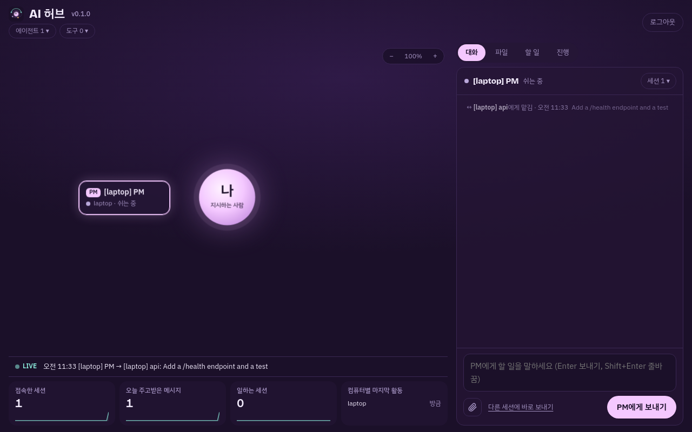

# AI Hub

**A small self-hosted hub to watch, instruct and share files with many Claude Code sessions from one page.**
[한국어](README.md)

> License: [MIT](LICENSE)


<!-- more screenshots: docs/images/chat.png (chat), docs/images/files.png (files) -->

When you run several Claude Code sessions with different jobs (PM, dev, ops, design…) on several machines, it gets hard to tell who is doing what, who handed work to whom, and where something is stuck. AI Hub collects the signals each session's Claude Code **hooks** send, shows them on one page, and lets you **send instructions** to a session from the browser, receive **to-dos** a session needs from you, and pass **files** around.

- **Map**: session cards and the work moving between them (instructions, hand-offs, reports)
- **Chat**: your conversation with the selected session (PM by default), attachments, `@tool` mentions
- **Progress**: one line per job (sent / in progress / done) and estimated token usage per session
- **To-do**: things a session needs you to do (approve, log in, pay…). Tick it and the session continues
- **Work board**: T-numbered tasks sessions hand each other, updated by one-line `@task` / `@done` messages; the PM reads only what changed
- **Session cards**: now / decided / todo / key files per session; "refresh" hands a long conversation over to a fresh session with the same name and folder
- **Files**: folders, previews, drag-and-drop upload, move, expiring share links
- **Tools**: write down how-tos and commands once, attach them to instructions
- **`aihub` CLI**: set up the hub, install hooks, and start / wake / stop background sessions that carry a role (CLAUDE.md)

## Quick start

You need **Node.js 22.13+**, **Claude Code** logged in (`claude auth login`), `curl` and `sh` (Git Bash on Windows).

```sh
git clone <this-repo> ai-hub && cd ai-hub
npm ci && npm link          # installs the `aihub` command
aihub init                  # writes .env (random password and tokens) and aihub.config.json; prints the web password once
aihub start                 # hub on http://localhost:4200
aihub hook install          # adds the hub hooks to Claude Code on this machine (backs up ~/.claude/settings.json, then merges)
aihub session add pm --role pm --trust   # PM session in the background (~/aihub-sessions/pm); Claude asks once to trust a new folder
aihub session add api --role dev --dir ~/code/my-api
aihub doctor                # checks everything
```

Open http://localhost:4200, log in with the password from `aihub init`, and tell the PM what you need in the chat. The PM hands work to the other sessions.

With Docker: `aihub init && aihub start --docker` (or `docker compose up -d --build`).

Other machines: make the hub reachable (`PUBLIC_URL` and `HOST` in `.env`, ideally behind HTTPS), run the one-liner from `aihub join-command` on that machine, and approve its code in the hub's to-do tab.

## Docs

The detailed docs are in Korean, each with an English summary at the top: [install](docs/install.md), [usage](docs/usage.md), [concepts](docs/concepts.md), [work board](docs/tasks.md), [architecture](docs/architecture.md), [Claude integration](docs/claude-integration.md), [security](docs/security.md), [FAQ](docs/faq.md), [contributing](CONTRIBUTING.md), [changelog](CHANGELOG.md), [third-party licenses](THIRD_PARTY_LICENSES.md).

## Status

0.1 — the first public cut of a hub one person used to run sessions across their own machines, now generalized. The web UI text is Korean only for now. There is no desktop or mobile app yet (use the browser or "add to home screen").

This is a community tool, not affiliated with Anthropic. Claude and Claude Code are trademarks of Anthropic.
