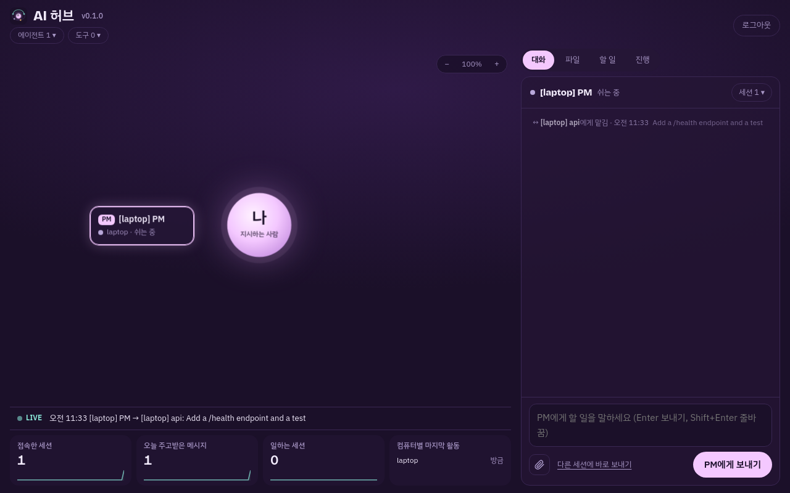

# AI Hub

**여러 Claude Code 세션을 한 화면에서 보고, 지시하고, 파일을 나누는 작은 자체 호스팅 허브.**
[English](README.en.md)

> 라이선스: [MIT](LICENSE)


<!-- 스크린샷 더 넣을 자리: docs/images/chat.png (대화), docs/images/files.png (파일) -->

여러 컴퓨터에서 Claude Code 세션을 역할별로(PM·개발·배포·디자인…) 띄워 두면, 지금 누가 무엇을 하는지, 누가 누구에게 일을 맡겼는지, 어디서 막혔는지 알기 어렵습니다. AI Hub는 각 세션의 Claude Code **hook**이 보내는 신호를 모아 보여 주고, 브라우저에서 세션에 **지시를 보내고**, 세션이 사용자에게 맡긴 **할 일**을 받고, **파일**을 주고받게 해 줍니다.

- **지도**: 세션 카드와 지금 오가는 일(지시·맡김·보고)
- **대화**: 고른 세션(기본 PM)과 나의 대화, 첨부, `@도구` 붙이기
- **진행**: 일 한 줄씩(지시됨·진행 중·완료), 세션별 토큰 사용량(추정)
- **내 할 일**: 세션이 사용자에게 맡긴 일(승인·로그인·결제 등). 체크하면 그 세션이 이어서 진행
- **작업**: 세션끼리 나눈 T번호 작업 보드. `@task`·`@done` 한 줄 메시지로 세션이 직접 고치고, PM은 바뀐 것만 받음
- **세션 카드**: 세션마다 지금 하는 일·정한 것·남은 일·중요 파일. 대화가 길어지면 "정리하고 새로 시작"으로 같은 이름·폴더의 새 세션에 넘김
- **파일**: 폴더·미리보기·끌어 놓기 올리기·옮기기·기한 있는 공유 링크
- **도구**: 자주 쓰는 방법·명령을 적어 두고 지시에 붙이기
- **`aihub` CLI**: 허브 설치, 훅 설치, 역할(CLAUDE.md)을 가진 세션 띄우기·깨우기·멈추기

## 빠른 시작

필요한 것: **Node.js 22.13+**, **Claude Code**(`claude auth login`으로 로그인), `curl`, `sh`(윈도우는 Git Bash).

```sh
git clone <this-repo> ai-hub && cd ai-hub
npm ci && npm link          # `aihub` 명령 설치
aihub init                  # .env(무작위 비밀번호·토큰)와 aihub.config.json 만들기 — 화면 비밀번호가 한 번 출력됨
aihub start                 # http://localhost:4200 에서 허브 시작
aihub hook install          # 이 컴퓨터의 Claude Code에 허브 훅 넣기 (~/.claude/settings.json 백업 후 합침)
aihub session add pm --role pm --trust   # PM 세션을 백그라운드로 (~/aihub-sessions/pm). 처음 쓰는 폴더는 Claude가 한 번 신뢰를 물음
aihub session add api --role dev --dir ~/code/my-api
aihub doctor                # 전부 맞는지 점검
```

브라우저에서 http://localhost:4200 을 열고 `aihub init`이 보여 준 비밀번호로 들어갑니다. 대화창에서 PM에게 일을 말하면 PM이 다른 세션에 나눠 맡깁니다.

Docker로: `aihub init && aihub start --docker` (또는 `docker compose up -d --build`).

다른 컴퓨터 붙이기: 허브를 그 컴퓨터에서 닿는 주소로 열고(`.env`의 `PUBLIC_URL`, `HOST`), `aihub join-command`가 알려 주는 한 줄을 그 컴퓨터에서 실행한 뒤 허브 '할 일'에서 승인 코드를 확인합니다.

## 문서

| 문서 | 내용 |
|---|---|
| [설치](docs/install.md) | npm·Docker 설치, 다른 컴퓨터 붙이기, HTTPS 프록시 |
| [사용법](docs/usage.md) | 화면과 `aihub` 명령 전체 |
| [개념](docs/concepts.md) | 세션·역할·도구·할 일·PM |
| [작업 보드](docs/tasks.md) | T번호 작업, `@task`·`@done` 규격, 세션 카드, 정리하고 새로 시작, 역할별 모델 |
| [구조](docs/architecture.md) | 구성 요소와 데이터 흐름, API |
| [Claude 연동](docs/claude-integration.md) | 훅·SendMessage·Remote Control·백그라운드 세션이 하는 일 |
| [보안](docs/security.md) | 무엇을 저장·전송하는지, 권한 원칙 |
| [FAQ](docs/faq.md) | 자주 묻는 것 |
| [기여](CONTRIBUTING.md) · [변경 기록](CHANGELOG.md) · [의존 라이선스](THIRD_PARTY_LICENSES.md) | |

## 상태

0.1 — 한 사람이 여러 컴퓨터의 세션을 다루는 용도로 쓰던 것을 일반화한 첫 공개판입니다. 화면 글자는 지금 한국어만 있습니다. 데스크톱·모바일 앱은 아직 없습니다(브라우저·홈 화면 추가로 씀).

이 프로젝트는 Anthropic과 관계없는 커뮤니티 도구입니다. Claude, Claude Code는 Anthropic의 상표입니다.
